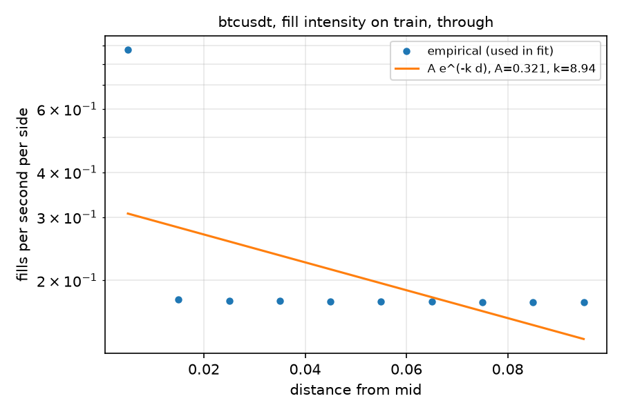
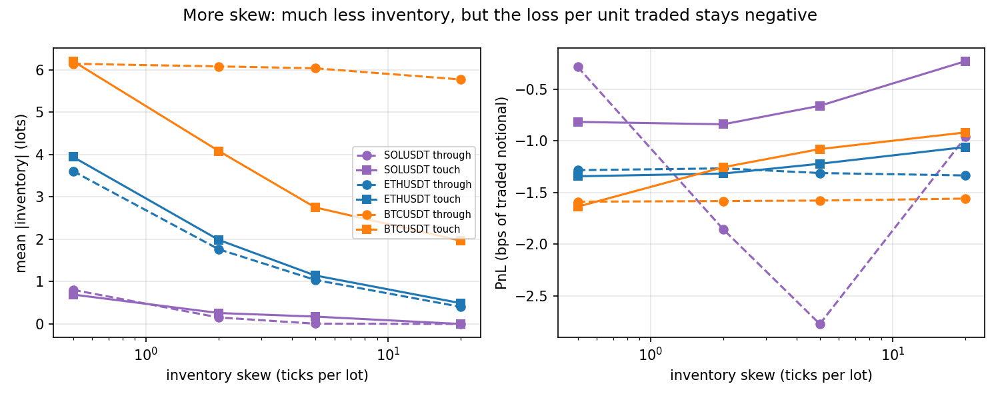
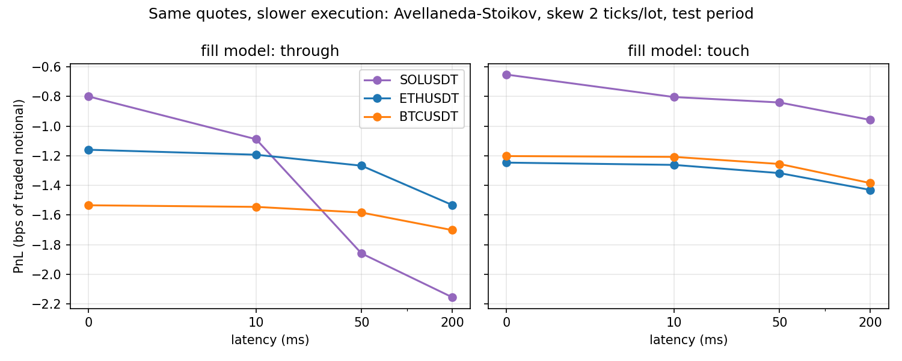

# Market making under inventory risk

**Avellaneda-Stoikov market making, backtested on real crypto order book data.**

A market maker earns the bid-ask spread but carries inventory risk: every fill leaves it long or short
until the opposite trade arrives, and fills tend to come right before the price moves against it
(adverse selection). This project tests the closed-form Avellaneda-Stoikov strategy on 24 hours of real
Binance data: how well its model fits, how much inventory control helps, and how much latency and a simple
order book signal (the microprice) change the result.

> Status: the Avellaneda-Stoikov study is complete (see [Results](#results)).
> Possible extensions are listed under [Next steps](#next-steps).

## The model

Avellaneda & Stoikov (2008) model the mid price as Brownian motion with volatility $\sigma$ and the arrival of
market orders that reach a distance $\delta$ from the mid as a Poisson process with intensity
$\lambda(\delta) = A e^{-k\delta}$. For a market maker with exponential utility (risk aversion $\gamma$)
holding $q$ lots, the optimal quotes are centred on a **reservation price**

$$r = s - q\,\gamma\,\sigma^2\,\tau$$

with total spread

$$\delta^a + \delta^b = \gamma\,\sigma^2\,\tau + \frac{2}{\gamma}\ln\!\left(1 + \frac{\gamma}{k}\right).$$

Long inventory pushes both quotes down (sell more readily, buy less), short inventory pushes them up.
Crypto trades 24/7, so instead of a fixed end time the horizon $\tau$ is a rolling window in seconds.

## Method

1. **Data.** Binance public websocket streams: top-10 order book every 100 ms and every aggregated trade.
2. **Calibration** on the first half of the data only (no look-ahead).
   $\sigma$ comes from 1-second mid changes. $A$ and $k$ are measured **the same way the backtester fills orders**:
   for every quote interval (one 100 ms snapshot to the next, shifted by the latency) we record how far below the
   starting mid sellers traded and how far above it buyers traded. The share of intervals in which a quote at
   distance $\delta$ would have been filled is turned into a Poisson rate $\lambda(\delta)$ by maximum likelihood
   (intervals have different lengths), and $\log\lambda(\delta) = \log A - k\delta$ is fitted by least squares.
   A unit test checks that a quote at distance $\delta$ then really is filled about $\lambda(\delta)$ times per second
   in the backtest.
3. **Backtest** on the second half. At each snapshot the strategy posts one bid and one ask; quotes go live
   after a latency (default 50 ms). Fill models:
   - `through` (conservative): a bid fills only if someone sells *below* it.
   - `touch` (optimistic): a bid fills if someone sells *at* it, as if we were always first in the queue.

   The truth lies between the two, so every run reports both (calibration included).
4. **Metrics.** PnL marked to mid, PnL in bps of traded notional, a **Newey-West t-statistic of the 10-minute PnL changes**
   ($|t| < 2$: the result could easily be luck), max drawdown, inventory statistics, spread captured per fill and
   **markouts** at 1 s, 10 s and 60 s ($\text{side} \times (\text{mid}_{t+h} - \text{fill price})$) to measure adverse selection.
   An annualised Sharpe ratio is deliberately not reported: on a few hours of data with long flat stretches it is meaningless.

5. **Microprice variant.** The same Avellaneda-Stoikov quotes centred on the microprice
   $(\text{bid} \cdot q_{ask} + \text{ask} \cdot q_{bid}) / (q_{bid} + q_{ask})$ instead of the mid. The microprice leans
   towards the thinner side of the book, where the price tends to move next (Stoikov, 2018), so it is a natural
   first defence against adverse selection. Both versions are always reported side by side.
   Micro and mid versions are compared **on the same data** with a Newey-West t-statistic of the difference in
   PnL changes, which is far sharper than comparing two separate t-statistics.
6. **Latency sweep** (`scripts/latency_sweep.py`): the strategy is calibrated once, so its quotes are identical,
   and only the execution latency changes (0, 10, 50, 200 ms). Differences are then caused by speed alone.
   The book is recorded every 100 ms, so latencies below that are only partly measurable.

**Risk aversion** is set as *ticks of quote shift per lot of inventory* (`--skew-ticks`), i.e.
$\gamma = \text{skew} \cdot \text{tick} / (\sigma^2 \tau)$. A raw $\gamma$ means very different things on BTC and SOL;
an earlier version scaled $\gamma$ with $k$ and produced spreads of hundreds of dollars on BTC (no fills at all).

The baseline is a symmetric quoter with the **same average spread** as the middle Avellaneda-Stoikov
strategy, so any difference comes from inventory management, not from quoting wider.

## Project structure

```
src/mm/
  recorder.py     record order book + trades from Binance
  data.py         load recordings into numpy arrays (Market)
  synthetic.py    synthetic market with known sigma, A, k (for tests)
  calibration.py  estimate sigma, A, k
  strategies.py   Symmetric baseline, AvellanedaStoikov (mid- or microprice-centred)
  backtest.py     event-driven backtester (latency, fill models, fees)
  metrics.py      PnL, Newey-West t-statistics, paired tests, drawdown, inventory, markouts
  plots.py        figures
scripts/run_backtest.py   calibrate on train, backtest on test, save table + figures
scripts/latency_sweep.py  same quotes at different execution latencies
scripts/run_all.py        every backtest and sweep in one go, log in results/run_all_log.txt
scripts/make_figures.py   README figures from the CSVs in results/ into docs/figures/
tests/                    unit tests (pytest)
```

## Setup

```bash
python -m venv .venv
.venv\Scripts\activate            # Windows  (macOS/Linux: source .venv/bin/activate)
pip install -e ".[dev]"
pytest
```

## Usage

Record data (leave it running; stop with Ctrl+C, files are closed and compressed safely):

```bash
python -m mm.recorder --symbols btcusdt ethusdt solusdt --hours 24 --out C:\mm_data
```

Run the pipeline on synthetic data, then on a recording (here stored outside the repo in `C:\mm_data`):

```bash
python scripts/run_backtest.py --synthetic
python scripts/run_backtest.py --symbol solusdt --notional 100 --data-dir C:\mm_data
python scripts/run_backtest.py --symbol btcusdt --notional 100 --data-dir C:\mm_data --fill-mode through
```

`--notional 100` sizes every order at about 100 USDT, so different coins are comparable.
`--fit-ticks 10` fits the fill intensity only on the first 10 price levels, where a market maker actually quotes.

```bash
python scripts/latency_sweep.py --symbol solusdt --notional 100 --data-dir C:\mm_data --fit-ticks 10
```

To reproduce everything in the Results section (about 7 minutes), then rebuild the figures:

```bash
python scripts/run_all.py --data-dir C:\mm_data
python scripts/make_figures.py
```

## Results

All numbers come from one command, `python scripts/run_all.py --data-dir <recordings>`, followed by
`python scripts/make_figures.py`. Data: Binance spot, 24 hours on 8-9 November 2026, BTC/USDT, ETH/USDT and
SOL/USDT; calibration on the first 12 hours, **test on the last 12 hours**. Orders of about 100 USDT, 50 ms
latency, zero fees, fill intensity fitted on the first 10 price levels. The median spread was one tick on all
three pairs, and all three fell during the test day (BTC -1.9%, ETH -5.5%, SOL -3.7% over the 24 hours).

> **One day of data.** A t-statistic beyond ±2 means an effect is unlikely to be luck *within this sample*;
> it does not show that the effect holds on other days or in other market regimes.

### 1. The exponential fill model breaks down at the best price

| | measured at the best price | exponential fit | measured one tick further |
|---|---|---|---|
| BTC/USDT (through) | 0.88 fills/s | 0.31 | 0.18 |
| SOL/USDT (touch) | 0.51 | 0.16 | 0.09 |
| ETH/USDT (touch) | 0.76 | 0.42 | 0.29 |



There are two regimes: at the best price a quote is filled by ordinary order flow (a queue game); one tick or
more away it is filled only when the price sweeps through it. On BTC the rate is flat from 1.5 to 9.5 ticks,
because a move that goes through one level usually goes through ten. Avellaneda-Stoikov assumes a single
exponential, so its "optimal" quotes sit in the second regime. The one exception is ETH under the `through`
model, where the exponential fits the first ten levels almost perfectly.

### 2. Avellaneda-Stoikov controls inventory, but loses to adverse selection on BTC and ETH

PnL in bps of traded notional (Newey-West t-statistic, mean |inventory| in lots), test period:

| pair, fill model | symmetric | AS skew 0.5 | AS skew 2 | AS skew 5 | AS skew 20 |
|---|---|---|---|---|---|
| BTC, through | -1.59 (t -9.8, 6.2) | -1.59 (-9.7, 6.1) | -1.58 (-9.8, 6.1) | -1.58 (-9.8, 6.0) | -1.56 (-9.7, 5.8) |
| BTC, touch | -1.63 (-10.1, 6.2) | -1.64 (-10.1, 6.2) | -1.26 (-10.4, 4.1) | -1.08 (-10.0, 2.8) | -0.92 (-9.6, 2.0) |
| ETH, through | -1.42 (-5.0, 5.5) | -1.28 (-5.3, 3.6) | -1.27 (-6.0, 1.8) | -1.31 (-6.5, 1.0) | -1.34 (-6.3, 0.4) |
| ETH, touch | -1.31 (-6.4, 6.0) | -1.34 (-7.2, 3.9) | -1.32 (-7.6, 2.0) | -1.22 (-7.6, 1.1) | -1.06 (-7.0, 0.5) |
| SOL, through | +51.6 (1.4, 6.0) | -0.29 (-0.5, 0.8) | -1.86 (-3.0, 0.2) | -2.77 (-4.0, 0.0) | -0.96 (-0.5, 0.0) |
| SOL, touch | +25.4 (2.1, 5.6) | -0.82 (-3.2, 0.7) | -0.84 (-4.1, 0.3) | -0.66 (-2.6, 0.2) | -0.23 (-0.3, 0.0) |



- **Inventory control works as designed.** Going from 0.5 to 20 ticks of skew cuts mean inventory by 8-9x on ETH,
  by 3x on BTC under `touch`, and almost to zero on SOL (where fills also become rare). Under `through`, BTC barely
  reacts: the standard deviation of a 100 ms BTC move is about 180 ticks, so even 20 ticks of skew per lot is small.
- **The loss per unit traded stays negative.** No configuration makes money on BTC or ETH; t-statistics stay
  between -5 and -10. One second after a fill the mid has already moved against us by more than the spread we
  captured (ETH: captured about 0.08-0.15 USDT, one-second markout about -0.21 to -0.25 USDT). Under `touch`,
  more skew reduces the loss per unit (BTC from -1.64 to -0.92 bps), but does not remove it.
- **The symmetric "wins" on SOL are a directional bet, not market making.** It held about 6 lots of inventory on
  average, mostly short and often at the 10-lot limit, while SOL fell; it made 39-160 fills and its t-statistic
  is 1.4-2.1. The same quoter loses on BTC and ETH.
  On SOL with skew 20 there are only 6-11 fills, so those cells are noise.

### 3. Latency: the same quotes do worse when they arrive later



With identical quotes and only the execution latency changed (0, 10, 50, 200 ms), PnL per unit traded gets
worse with latency on **all three pairs and under both fill models** (6 of 6 curves monotone). Example: on
BTC under `through` the spread captured per fill falls from +0.12 to -0.86 USDT, i.e. at 200 ms we are filled
at prices the market has already left. On BTC and ETH most of the effect is between 50 and 200 ms; below
100 ms the recording (one book snapshot per 100 ms) cannot resolve much.

### 4. Centring quotes on the microprice helps a little

Paired test on the same data (micro minus mid, Newey-West t of the difference in PnL changes): the
microprice version is better in 20 of 24 backtest comparisons (one of them by a negligible amount), 12 of them with t > 2, and significantly worse in
one (SOL `through`, skew 5, t = -2.4). The effect is largest on ETH under `touch` (t 4.7 to 6.2) but small in
size: about 2.6-7.8 USDT on losses of 100-230 USDT. It reduces adverse selection without turning losses into
profits, which makes sense: the microprice moves the centre by less than half a tick, while the quotes sit
several ticks away.

### Summary

On this day, on liquid crypto pairs with a one-tick spread, a passive Avellaneda-Stoikov market maker that sees
the book every 100 ms was systematically picked off. Inventory control reduces risk, the microprice and lower latency
reduce the damage, but none of them removes it. The missing ingredients are the ones real market makers
compete on: queue position at the best price, speed well below 100 ms, and short-term signals stronger than
the top-of-book imbalance. The first two are beyond what this dataset can test; a
reinforcement-learning agent with richer book signals is a natural next step (see [Next steps](#next-steps)).

## Lessons from the first run

The first version estimated $k$ from the distance between each trade and the mid of the last book snapshot.
On BTC/USDT this gave an "optimal" spread of about 26 USDT, roughly 2,600 ticks, while the market spread is one tick:
in 100 ms BTC moves by almost 2 USDT, so the estimator was measuring price noise between snapshot and trade, not
how deep market orders reach. Calibration now measures fills per quote interval, consistently with the backtester.

The first backtest also showed strong **adverse selection**: markouts were negative already after one second.
Part of this is structural to the conservative `through` fill model (we are only filled when the price moves
through our quote), which is why every run now also reports the optimistic `touch` model.

## Limitations

- **Queue position is unknown.** The `through`/`touch` bounds bracket the true fill rate; neither is exact.
- **No market impact.** Our orders are assumed small enough not to change other traders' behaviour.
- **Fees.** Default maker fee is 0 (professional market makers often pay zero or receive rebates);
  `--fee-bps` shows how quickly a retail fee schedule removes the edge.
- **Model assumptions.** Brownian mid and exponential fill intensity are approximations;
  the intensity plot shows how well the exponential fits real trades.
- **One day, one regime.** All results come from a single 24-hour recording in which all three pairs fell.
- **Book snapshots every 100 ms**, so very fast price moves between snapshots are not observed.

## Next steps

- Record several more days, to test whether the results hold across market regimes.
- A reinforcement-learning agent (e.g. DQN) that chooses spread and skew from inventory, volatility and
  order book imbalance, compared with Avellaneda-Stoikov out of sample under both fill models.
- A fill model with queue position at the best price, where the exponential model breaks down.

## References

- M. Avellaneda, S. Stoikov (2008). *High-frequency trading in a limit order book.* Quantitative Finance 8(3).
- O. Guéant, C.-A. Lehalle, J. Fernandez-Tapia (2013). *Dealing with the inventory risk: a solution to the market making problem.* Mathematics and Financial Economics 7.
